# Quản lý kết quả học tập sinh viên (Python + JSON)

Bài A1 – Xử lý dữ liệu có cấu trúc với JSON

Chương trình dòng lệnh quản lý điểm của một nhóm sinh viên: nhập dữ liệu, tính điểm môn và GPA, lưu/đọc file JSON, tìm kiếm, sắp xếp và thống kê.

## Yêu cầu

- Python 3.8 trở lên
- Không cần cài thư viện ngoài (chỉ dùng thư viện chuẩn: `json`, `os`, `shutil`, `copy`, `unicodedata`, `decimal`)

## Cách chạy

**Trong PyCharm:** mở file `quan_ly_sinh_vien.py` → chuột phải → *Run 'quan_ly_sinh_vien'*.

**Trong terminal:**

```bash
python quan_ly_sinh_vien.py
```

File dữ liệu `sinh_vien.json` được tạo tự động cùng thư mục với file `.py` khi chọn chức năng *Lưu* (hoặc chọn lưu khi thoát). Lần chạy sau, chương trình tự đọc lại file này.

## Chức năng

| Mục | Chức năng |
|---|---|
| 1 | Nhập sinh viên mới (MSSV, họ tên, danh sách môn, điểm) |
| 2 | Thêm môn học cho sinh viên đã có (tự tính lại GPA) |
| 3 | Hiển thị danh sách chi tiết |
| 4 | Tìm kiếm theo MSSV hoặc họ tên (gõ không dấu vẫn tìm được) |
| 5 | Sắp xếp theo GPA (tăng dần / giảm dần) |
| 6 | Thống kê: GPA cao nhất, thấp nhất, trung bình nhóm |
| 7 | Lưu dữ liệu vào file JSON |
| 8 | Đọc lại dữ liệu từ file JSON |
| 9 | Xóa sinh viên |
| 0 | Thoát |

## Quy tắc tính điểm

- Mỗi môn có 2 điểm thành phần, nhập trong khoảng **0–10**.
- `Điểm môn = Điểm TP1 × 0.4 + Điểm TP2 × 0.6` → làm tròn **1 chữ số thập phân**.
- `GPA` = trung bình cộng điểm tổng kết các môn → làm tròn **2 chữ số thập phân**.
- Làm tròn theo quy tắc thông thường (0.05 → 0.1) bằng `decimal`, tránh sai số của số thực.

## Cấu trúc file JSON

```json
[
    {
        "mssv": "50.01.104.159",
        "ho_ten": "Phạm Thành Thuật",
        "mon_hoc": [
            {
                "ten_mon": "Toán rời rạc",
                "diem_tp1": 6.0,
                "diem_tp2": 8.0,
                "diem_tong_ket": 7.2
            },
            {
                "ten_mon": "Toán cơ sở",
                "diem_tp1": 8.0,
                "diem_tp2": 9.0,
                "diem_tong_ket": 8.6
            }
        ],
        "gpa": 7.9
    }
]
```

## Xử lý lỗi

- Nhập điểm sai (chữ, ngoài 0–10): báo lỗi và yêu cầu nhập lại.
- MSSV trùng, tên môn trùng, để trống: không cho phép.
- File JSON chưa tồn tại: thông báo và bắt đầu với danh sách rỗng.
- File JSON bị hỏng: thông báo, chuyển file gốc thành `sinh_vien.json.bak` để không bị ghi đè mất dữ liệu, chương trình vẫn chạy bình thường.
- Dữ liệu trong JSON được kiểm tra khi đọc (đủ trường, điểm là số 0–10, không trùng MSSV). Bản ghi sai sẽ bị bỏ qua kèm thông báo lý do, file gốc được sao lưu ra `.bak`; điểm tổng kết và GPA được tính lại cho nhất quán.
- Chọn *Đọc lại JSON* khi đang có thay đổi chưa lưu: chương trình hỏi xác nhận trước khi ghi đè dữ liệu trong bộ nhớ. Khi thoát mà có thay đổi chưa lưu, chương trình hỏi có muốn lưu không.
- Nhấn `Ctrl+C` trong lúc nhập: hủy thao tác và quay lại menu.

## Hình ảnh chạy thử nghiệm (Demo)

### 1. Nhập sinh viên mới & Thêm môn học
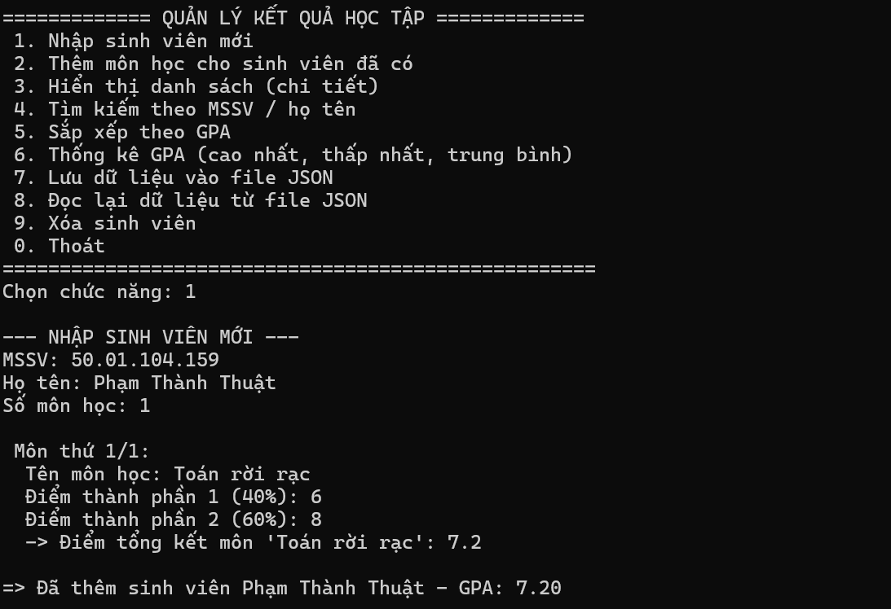
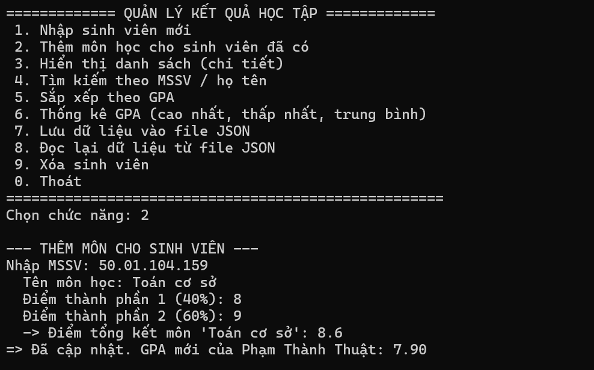

### 2. Hiển thị danh sách & Tìm kiếm (theo MSSV / Họ tên)
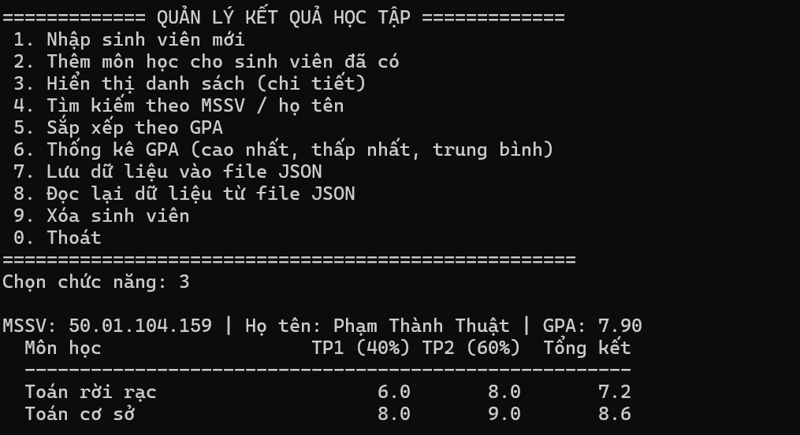
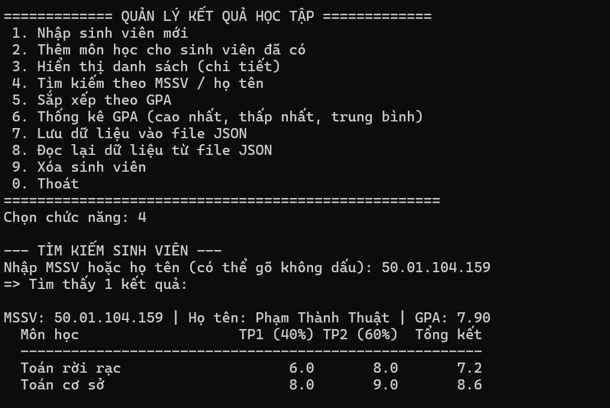
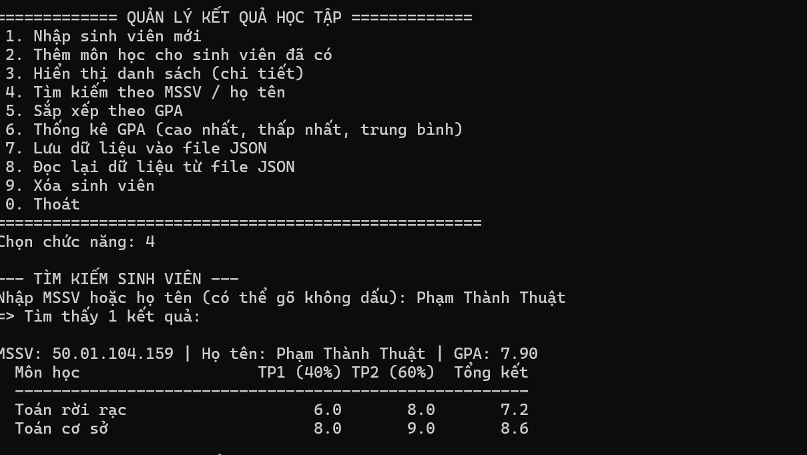

### 3. Sắp xếp theo GPA & Thống kê nhóm
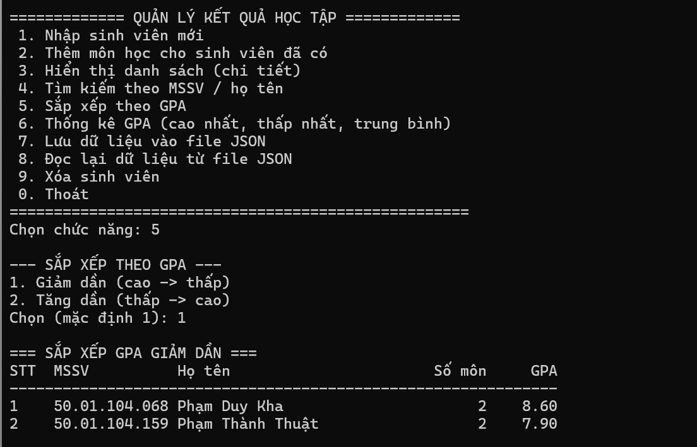
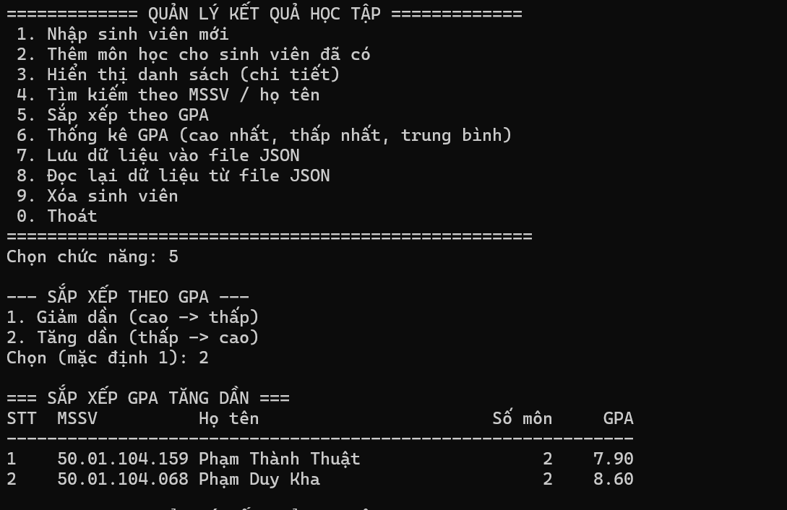
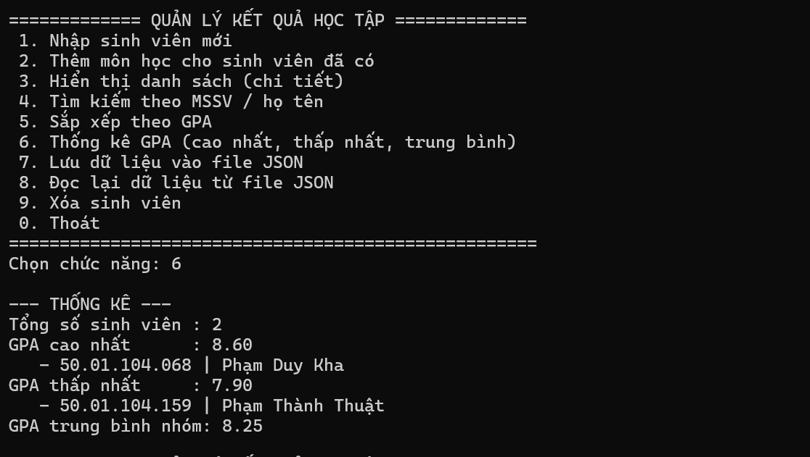

### 4. Lưu file JSON, Xóa dữ liệu & Đọc lại từ JSON
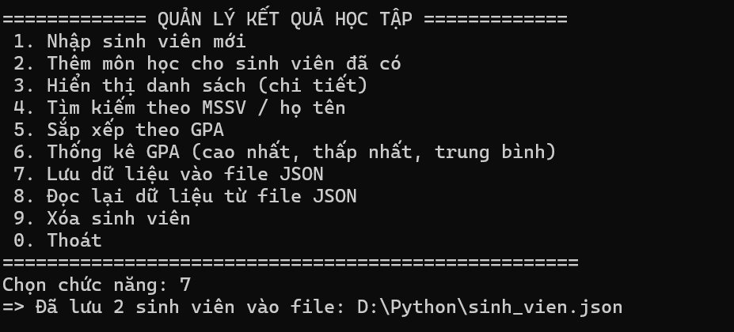
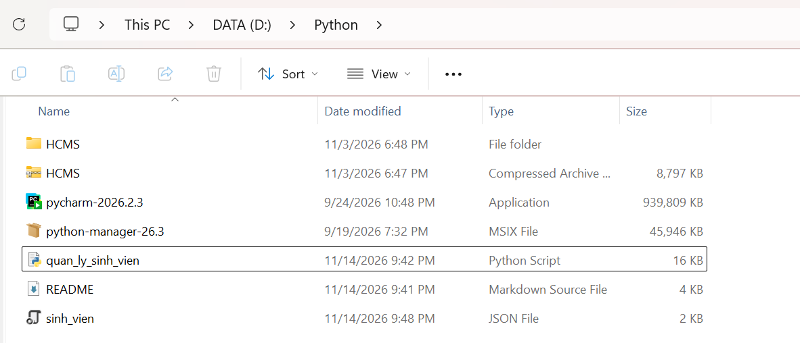
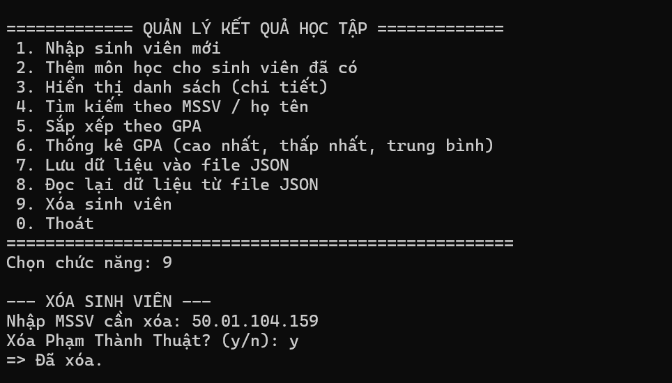
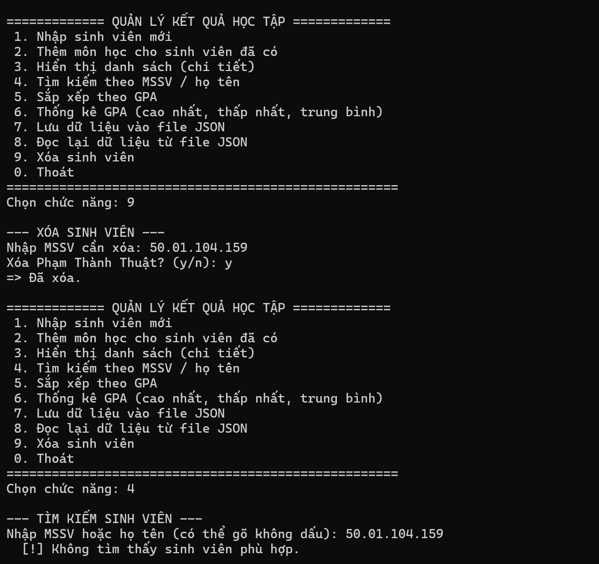
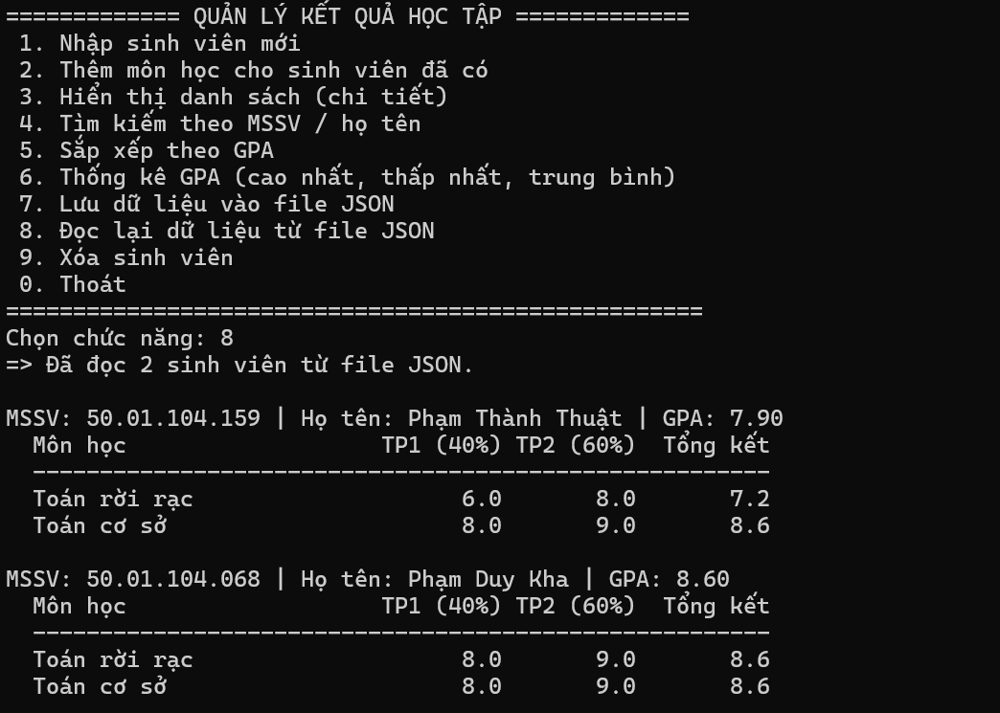
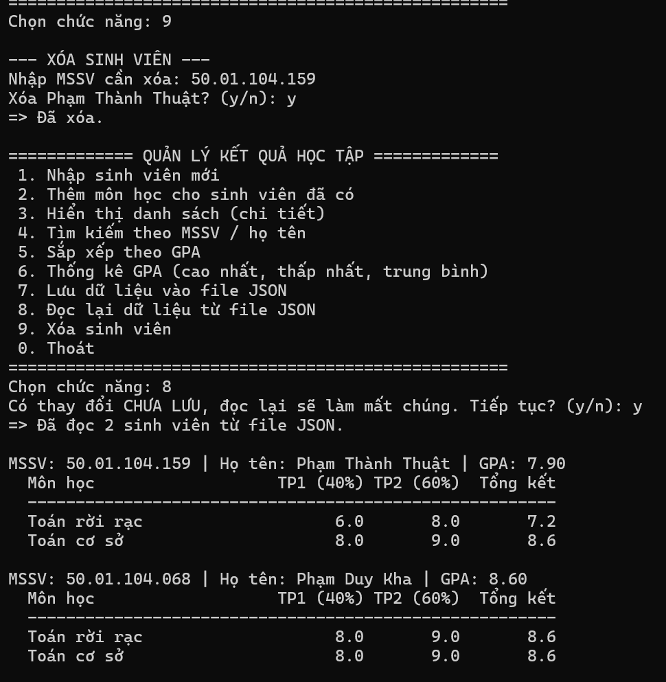

> **Lưu ý:** chức năng xóa (9) và tìm kiếm (4) chỉ làm việc trên dữ liệu trong bộ nhớ, nên sau khi xóa, tìm lại MSSV sẽ không thấy. File `sinh_vien.json` không bị ảnh hưởng cho tới khi lưu (chức năng 7), vì vậy chức năng 8 khôi phục lại đầy đủ. Nếu đã lưu (7) sau khi xóa thì dữ liệu cũ trong file bị ghi đè và không đọc lại được.

## Cấu trúc thư mục

```
.
├── quan_ly_sinh_vien.py   # mã nguồn chính
├── sinh_vien.json         # dữ liệu (tự tạo sau khi lưu)
├── images/                # ảnh chụp màn hình demo chức năng
└── README.md
```
